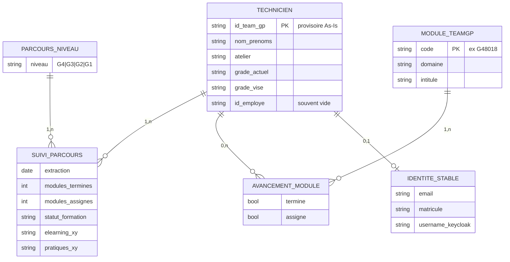

# Étude SI As-Is — Suivi Techniciens (02/09/2026)

**Source :** `docs/Suivi_Techniciens_02-09-2026_harmonise.xlsx`  
**Méthode :** skill `etude-si` (pipeline As-Is → urbanisation → MCD → rejets → dry-run)  
**Date d’analyse :** 4 septembre 2026  
**Statut :** **Étape 1–3 amorcées** — pas de dry-run / pas d’import (volontaire)

Artefacts techniques :
- `docs/etude-si-suivi-techniciens-2026-09-02/as_is_raw.json`
- `docs/etude-si-suivi-techniciens-2026-09-02/as_is_deep.json`
- Scripts : `scripts/etude_si_suivi_techniciens_as_is.py`, `…_deep.py`

---

## 0. Verdict en une phrase

> Ce classeur est le **SI de suivi Toyota TEAM-GP** (parcours G4→G1, e-learning + évaluations pratiques) pour **62 techniciens** Cameroun Mobility — **pas** le planning Academy CFAO (`TS01-G4`…), et **pas** encore un export directement importable tel quel.

---

## 1. Diagnostic As-Is (mesurer avant de modéliser)

### 1.1 Structure du classeur

| Élément | Mesure |
|---------|--------|
| Feuilles totales | **69** |
| Fiches individuelles `Fiche - …` | **62** |
| Feuilles transverses (pilotage) | **7** |
| Extraction mentionnée | 04/09/2026 — réf. 20/08/2026 — séance 02/09/2026 |
| Mentions légales As-Is | « DIFFUSION RESTREINTE : accès TEAM-GP réservés aux N+1 » |

**Feuilles transverses (source de vérité pour le pilotage) :**

1. `Synthèse` — 1 ligne ≈ 1 technicien (rang, atelier, ID TEAM-GP, grades, taux…)
2. `Sommaire des fiches` — navigation / index
3. `Modules critiques G4` — 1 ligne ≈ 1 module (taux de terminaison)
4. `Évolution planning`
5. `Avancement par domaine`
6. `Validation par type`
7. `Activité & scores`

**Fiches :** 1 feuille ≈ 1 technicien (identité + avancement + détail modules).  
Ex. `Fiche - NGUEFACK` = CEDRIC KITIO NGUEFACK.

### 1.2 Grain métier (à figer)

| Vue | Grain | 1 ligne = |
|-----|-------|-----------|
| `Synthèse` | **Personne / parcours** | 1 technicien suivi sur un niveau analysé (souvent G4) |
| `Fiche - X` | **Personne + détail** | blocs identité / KPIs / (puis modules) |
| `Modules critiques G4` | **Module catalogue TEAM-GP** | 1 module (code type `G48018`) + agrégats terminés/assignés |

**Ne pas confondre avec :**
- participation Academy (`sessions-2026` / `TS0x-Gy`) ;
- allocation MEDACAP PIF Academy (ex. KITIO : seulement `TS01-G4`, `TS02-G4` en Mongo) ;
- besoin campagne `cfao-needs`.

### 1.3 Volumes (feuille `Synthèse`)

En-têtes détectés (ligne ~7) :

`Rang | Atelier | ID TEAM-GP | NOMS ET PRENOMS | Grade actuel | Grade visé | Niveau du parcours analysé | Modules terminés | Modules assignés | Taux | e-learning | Éval. pratiques | Statut`

| Indicateur | Valeur (mesure openpyxl) |
|------------|--------------------------|
| Lignes data `Synthèse` | **64** (dont probablement 62 techs + totaux / lignes parasites — à recalculer au dry-run avec `norm()`) |
| Fiches individuelles | **62** |
| Techniciens G4 retenus (texte Modules critiques) | **32** (parcours G4 « complet ») |
| Modules G4 analysés | **143** |
| Modules G4 jamais terminés | **5** |
| Taux moyen de réalisation G4 (annoncé) | **36 %** |

**Grades actuels (comptage brut sur `Synthèse`) :**

| Grade actuel | Effectif |
|--------------|----------|
| Non certifié | 31 |
| PT | 8 |
| DMT | 6 |
| G4 | 4 |
| G3 | 2 |
| DTC / DTE / DTA / DTCL / TT | 2 chacun |
| G2 | 1 |

*Note : les libellés `PT`, `DMT`, `DTC`… sont des grades TEAM-GP / métier Toyota, distincts des seuls paliers `G4…G1` Academy.*

**Exemple KITIO (aligné portail KI) :**

| Champ As-Is | Valeur |
|-------------|--------|
| ID TEAM-GP | `GP•••••••` |
| Grade actuel | Non certifié |
| Grade visé | G4 |
| Niveau analysé | G4 |
| Modules terminés / assignés | **137 / 139** |
| e-learning | 117 / 117 |
| Éval. pratiques | 18 / 19 |
| Statut | En bonne voie |
| Atelier | CFAO MOBILITY CMR_Douala |

→ Le **SI Excel** voit un parcours TEAM-GP quasi complet ; le **PIF Academy MEDACAP** ne voit que 2 codes `TS*`. Ce sont **deux calendriers / deux catalogues**.

### 1.4 Glossaire As-Is → plateforme

| Terme fichier | Concept | Commentaire |
|---------------|---------|-------------|
| Technicien / Noms et prénoms | Personne (apprenant) | Identité nominative = DCP |
| ID TEAM-GP | Identifiant système constructeur | **Stable côté Toyota**, pas Keycloak |
| ID employé | Matricule RH | Souvent « — » dans l’échantillon |
| Atelier | Lieu / site filiale | Ex. Douala |
| Grade actuel / visé | Certification / objectif constructeur | ≠ `certLevels` Academy seul |
| Niveau de parcours analysé | Filtre G4/G3/… du suivi | |
| Module (code `G48…`) | Unité catalogue TEAM-GP | ≠ code fiche Academy `TS01-G4` |
| e-learning / e-test / éval. pratique | Modalités d’activité | |
| Accès TEAM-GP (N+1) | Compte manager constructeur | Hors portail CFAO |

### 1.5 Ce que le fichier **ne dit pas** (à modéliser explicitement)

- [ ] Email / matricule RH fiables pour ouvrir un compte Keycloak  
- [ ] Lien officiel `G48xxx` ↔ `TSxx-Gy` (mapping catalogue)  
- [ ] Statut d’inscription Academy (`a_inscrire` / `inscrit` / session datée)  
- [ ] Base légale DCP / durée de conservation du suivi nominatif  
- [ ] Règle de rejet si fiche sans `ID TEAM-GP`  
- [ ] Historique des extractions (seulement des libellés de date en en-tête)  
- [ ] Qui a le droit de voir les accès TEAM-GP N+1 hors Excel  

### 1.6 Qualité / résidus

- Classeur **harmonisé** (titre) : bonnes en-têtes métier, mais nombreuses formules / mises en forme (warnings openpyxl).  
- Feuilles « Modules critiques » : en-tête multi-lignes + KPI en haut → **ne pas** importer les 4 premières lignes comme data.  
- Noms de fiches = **nom de famille seulement** (`Fiche - NGUEFACK`) → collision possible si homonymes ; l’identité complète est dans la fiche / la Synthèse.  
- `ID employé` souvent vide → **ne pas** en faire une clé d’existence.

---

## 2. Urbanisation (ownership cible)

| Concept As-Is | Owner cible | Remarque |
|---------------|-------------|----------|
| Personne + atelier + grades | `cfao-core` **identity** | Après revue + id stable |
| Codes modules TEAM-GP + taux | **lms** (référentiel / suivi constructeur) *ou* store dédié « constructeur » | Pas `cfao-needs` |
| Sessions Academy / présence | **cfao-operations** | Autre SI |
| PIF Academy allocations | MEDACAP / portail (déjà live) | Ne pas écraser avec ce Excel |
| Agrégats anonymisés (taux module, counts) | versionnable éventuellement | **Sans nominatif** |
| Accès TEAM-GP N+1 | hors plateforme / secret | Ne pas committer |

**Minimisation DCP :** tout export vers `cfao-needs` = **interdit** (noms, ID TEAM-GP nominatifs).

---

## 3. Esquisse MCD Merise (brouillon — à valider)

**Règles dures (skill) :**
- Ne pas inventer de mapping `G48`→`TS` sans table officielle.  
- Clé personne provisoire = `ID TEAM-GP` **si présent** ; sinon cluster nom+prénom → **file de revue** (pas de `-2` auto).  
- Séparer calendrier TEAM-GP ≠ calendrier Academy.  
- Présence / « terminé » : enum **sans DEFAULT** qui masque le vide.

---

## 4. Règles de rejet proposées (avant tout script)

| Id | Règle | Sévérité |
|----|-------|----------|
| R1 | Ligne `Synthèse` sans `NOMS ET PRENOMS` | REJECT |
| R2 | Sans `ID TEAM-GP` | REJECT ou revue (à trancher) |
| R3 | `modules_terminés` > `modules_assignés` | REJECT |
| R4 | Code module vide dans liste G4 data | REJECT |
| R5 | Fiche orpheline (pas dans Synthèse) | WARNING + revue |
| R6 | Homonymie nom de fiche / 2 ID TEAM-GP | revue collision |
| R7 | Résidu `#VALUE!` / `#REF!` | exclu du grain data |
| R8 | Email/matricule absents | WARNING — bloque ouverture compte, pas l’existence personne |

*(Règles à figer en revue métier avant dry-run.)*

---

## 5. Lien avec le portail KI / MEDACAP (constat d’écarts)

| Source | Ce qu’on voit pour KITIO |
|--------|---------------------------|
| Excel TEAM-GP | 137/139 modules G4, quasi terminé |
| MEDACAP PIF Academy | 2 allocations `TS01-G4`, `TS02-G4` (`a_inscrire`) |

**Implication produit :** le détail PIF portail (Academy) **ne doit pas** prétendre afficher le suivi TEAM-GP de ce classeur sans intégration dédiée. Deux SI, deux vérités partielles.

---

## 6. Prochaines étapes (pipeline skill)

| # | Étape | Statut |
|---|-------|--------|
| 1 | Diagnostic As-Is | **Fait** (ce document) |
| 2 | Urbanisation | **Esquisse** — valider ownership constructeur |
| 3 | MCD Merise figé | **Brouillon** — atelier métier requis |
| 4 | Règles Rn numérotées validées | Proposé |
| 5 | Dry-run parse ≠ apply | **À faire** (script dédié, pas d’écriture DB) |
| 6 | Files de revue | Après dry-run |
| 7 | Collecte email / matricule | Après revue |
| 8 | Import réel | **Bloqué** tant que 5–7 non tranchés |

**UML :** non démarré (volontaire — Merise d’abord).

---

## 7. Checklist qualité (état)

- [x] Feuilles source identifiées ; fiches ≠ double-import transversal  
- [x] Grain écrit  
- [x] Volumes mesurés (ordre de grandeur)  
- [ ] `norm()` figée + tous les comptes recalculés au dry-run  
- [x] Glossaire + « ce que le fichier ne dit pas »  
- [x] Ownership esquissé  
- [ ] MCD validé métier  
- [ ] Dry-run + report + exit ≠ 0  
- [ ] Files de revue générées  

---

## 8. Recommandation pour le N+1 / métier

1. Traiter ce classeur comme **outil de pilotage TEAM-GP**, pas comme source unique du PIF Academy.  
2. Décider si CFAO Academy doit **ingérer** ce suivi (alors : mapping catalogue + DCP + dry-run) ou seulement **s’y référer** (lien / export N+1).  
3. Pour le portail KI : garder le PIF Academy sur `allocations` ; éventuellement afficher un bandeau « suivi constructeur TEAM-GP : voir classeur / prochaine intégration ».  

---

*Document produit selon `.claude/skills/etude-si` — pas d’écriture en base.*
