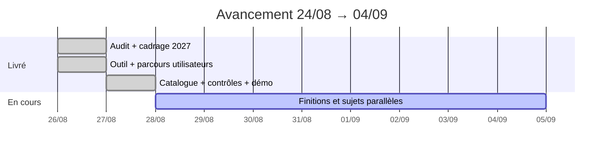

# État d’avancement — CFAO Academy  
## Période du 24 août au 4 septembre 2026

**Public :** N+1 / direction (non technique)  
**Durée :** 8 à 12 minutes  
**Type :** point d’avancement (ce qui a bougé sur la période) + décisions demandées  

---

## Slide 0 — En une phrase (à dire en premier)

> **Le nouvel outil de recueil des besoins de formation 2027 est prêt à être démontré.**  
> La campagne n’est pas encore ouverte en conditions réelles : il manque votre feu vert pour une démo / un pilote, et un arbitrage sur trois alertes de l’ancien outil.

---

## 1. Santé du projet (feu tricolore)

| Axe | Feu | Lecture simple |
|-----|-----|----------------|
| **Global** | 🟡 **Orange** | Avancée forte et démontrable, mais pas encore “ouvert en campagne” |
| Délai / livraison période | 🟢 Vert | Objectifs de la période tenus (outil utilisable, données chargées, contrôles faits) |
| Périmètre | 🟢 Vert | Cadrage 2027 posé ; règle “Academy valide avant envoi” en place |
| Qualité / contrôle | 🟢 Vert | Droits d’accès vérifiés ; démo bout en bout possible |
| Risques | 🟡 Orange | Catalogues métier encore incomplets + 3 alertes sur l’ancien outil |
| Budget | ⚪ Non traité ici | À compléter si vous suivez un budget dédié |

**Chemin vers le vert (global) :**  
date de démo campagne + responsable nommé sur les 3 alertes de l’ancien outil + décision des finitions d’écran encore en cours.

---

## 2. Où en est-on ? (réponse courte)

**Objectif métier :** permettre aux filiales de déclarer leurs besoins de formation 2027, et à l’Academy de contrôler avant tout envoi.

**Aujourd’hui :**
- un **nouvel outil** existe et **fonctionne** ;
- il utilise le **compte entreprise** (pas de mot de passe dans l’outil) ;
- une filiale ne voit que **son périmètre** ;
- **aucun message ne part** sans validation Academy ;
- le **catalogue de travail 2027** est chargé (environ 260 formations).

**Ce n’est pas encore :**
- une ouverture générale aux filiales en production ;
- la fin de toutes les finitions d’écran ;
- le traitement des alertes de sécurité de **l’ancien** outil.

---

## 3. Ce qui a été livré sur la période

### Réalisations (faits)

| # | Livrable | Pourquoi ça compte |
|---|----------|--------------------|
| 1 | Audit de l’outil actuel | On sait ce qu’on quitte ; **11 points** relevés dont **3 urgents** |
| 2 | Cadrage campagne 2027 | Plan de travail clair (25 étapes) + place au planning projet |
| 3 | Nouvel outil autonome | On peut le faire tourner **sans attendre** le reste de la plateforme |
| 4 | Parcours filiale → Academy | Saisie, transmission, relecture, contrôle avant envoi (FR / EN) |
| 5 | Catalogue 2027 chargé | Démo sur **données réelles**, pas sur un exemple fictif |
| 6 | Contrôles d’accès vérifiés | Les règles métier tiennent (58 contrôles au vert) |
| 7 | Cockpit de pilotage à jour | L’avancement affiché est **réel**, plus des données périmées |

### Schéma métier (à projeter)

**À dire :**

> « Avant : fichiers et ancien outil, avec des risques.  
> Maintenant : un circuit clair — la filiale déclare, l’Academy valide, puis seulement on envoie. »

---

## 4. Écarts et points d’attention

| Point | Impact | Action en cours / proposée | Qui doit agir |
|-------|--------|----------------------------|---------------|
| Catalogues incomplets (ex. Yamaha) | Certaines formations “en préparation” | Ouvrir quand même en le signalant clairement | Métier catalogue + projet |
| 3 alertes critiques — **ancien** outil | Risque même si on migre | À traiter **hors** migration | **À nommer** (sécurité / métier) |
| Finitions écran + portails (KI / confort) | Confort d’usage, pas le cœur campagne | Travail local encore à formaliser | Projet (prochaine itération) |
| Relances automatiques | Pas encore en place | Prévu après la démo campagne | Projet |

**À dire :**

> « Les écarts ne sont pas cachés.  
> Le plus important pour vous : les **trois alertes de l’ancien outil** ne disparaissent pas toutes seules parce qu’on change d’outil. »

---

## 5. Indicateurs (peu, utiles)

| Indicateur | Valeur |
|------------|--------|
| Livraisons tracées sur la branche recueil | 12 |
| Formations disponibles dans l’outil | ~260 |
| Contrôles d’accès réussis | 58 / 58 |
| Langues interface | Français + anglais |
| Statut période vs objectif “outil démontrable” | Atteint |
| Statut vs objectif “campagne ouverte” | Non atteint — étape suivante |

---

## 6. Décisions demandées (le cœur du point)

| # | Décision | Options | Recommandation |
|---|----------|---------|----------------|
| **D1** | Date de **démonstration** campagne 2027 ? | Semaine du … / plus tard | Fixer une date sous 2 semaines |
| **D2** | Qui traite les **3 alertes** de l’ancien outil ? | Nommer un responsable / reporter | Nommer un responsable **cette semaine** |
| **D3** | Priorité après la démo ? | Relances auto **ou** finitions d’écran | **Relances** (valeur métier directe) |

**À dire en fermant cette slide :**

> « Sans D1, on reste en “prêt mais pas montré”.  
> Sans D2, on laisse un risque connu sans propriétaire.  
> Sur D3, je recommande les relances pour ne pas courir après les filiales à la main. »

---

## 7. Prochaines étapes (jusqu’au prochain point)

1. Préparer la **démo campagne** (scénario filiale + Academy).  
2. Obtenir le **nom du responsable** des 3 alertes ancien outil.  
3. Ranger / tracer les finitions encore en local.  
4. Après démo validée : lancer le chantier **relances**.  

---

## 8. Aide-mémoire oral (si on vous coupe)

| Question | Réponse courte |
|----------|----------------|
| « C’est fini ? » | « Démontrable oui. Ouvert en campagne : pas encore — il manque votre feu vert. » |
| « Les filiales peuvent s’en servir demain ? » | « Pas en déploiement général. Oui pour une démo / un pilote encadré. » |
| « Pourquoi orange et pas vert ? » | « Parce que l’outil est prêt, mais la campagne n’est pas ouverte et des risques hors outil restent à arbitrer. » |
| « Et l’ancien outil ? » | « Audité. On ne s’y appuie plus pour 2027. Trois alertes urgentes à traiter à part. » |
| « Qu’est-ce que vous voulez de nous aujourd’hui ? » | « Une date de démo, un responsable pour les 3 alertes, et un choix de priorité ensuite. » |

---

## Annexe — Calendrier de la période (optionnel)

---

*Point d’avancement — format direction — CFAO Academy — 24 août → 4 septembre 2026*
