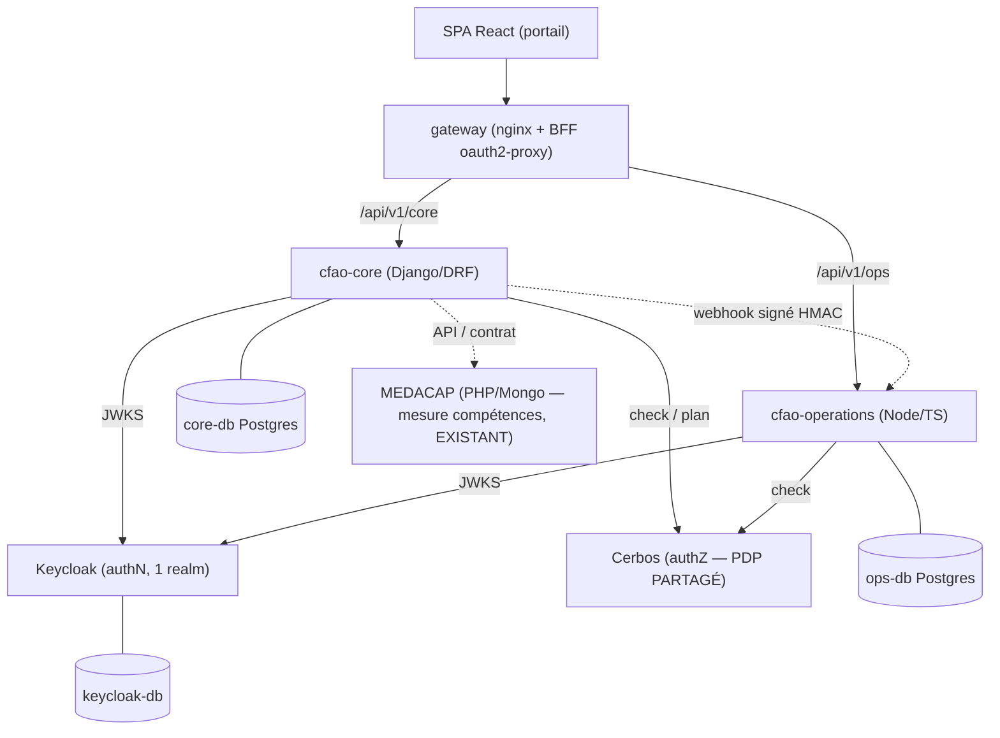
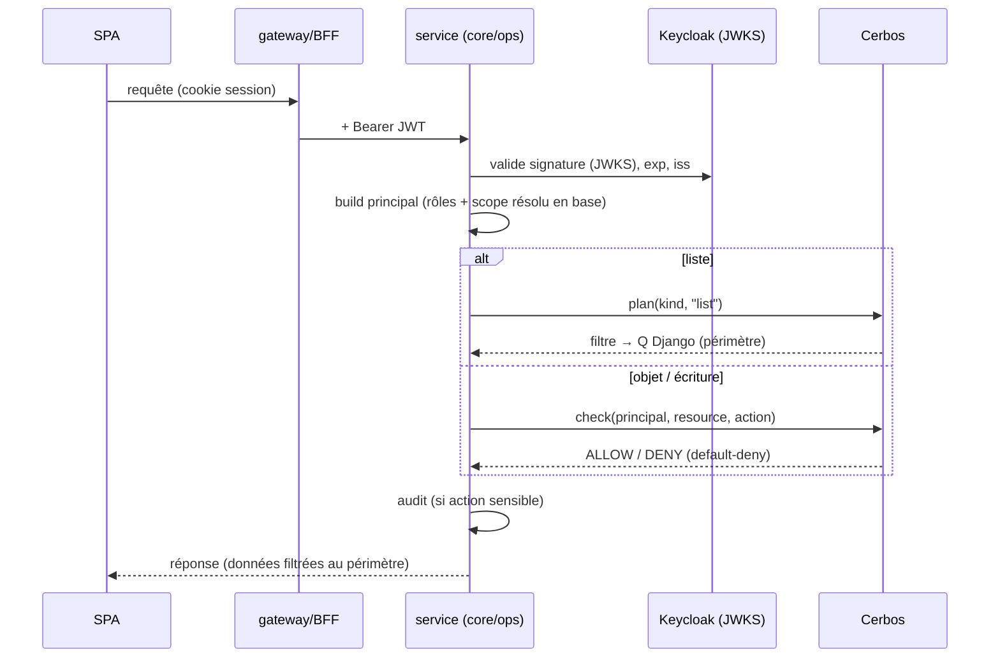

# CFAO Academy — Architecture backend : sous-applications, données & sécurité

État **réel** du backend (testé unitaire + Cerbos + live) et modèle de partage données/sécurité.
Complète `architecture.md` (design cible) et `BACKEND.md` (how-to). Journal : `walkthrough/`.

---

## 1. Vue d'ensemble — 2 services, 1 authN, 1 PDP partagé

- **cfao-core** (Django/DRF) — le **monolithe modulaire** métier (identity, audit, lms, … à venir recruitment/analytics/notifications/delivery).
- **cfao-operations** (Node/TS) — logistique temps réel (sessions, salles, planning, tickets — à venir).
- **Keycloak** — authentification unique. **Cerbos** — autorisation unique, **PDP partagé** par les deux services.
- **gateway** (nginx + BFF) — TLS, routage, flow OIDC, cookie httpOnly.

---

## 2. Les outils de la stack — quoi · pourquoi · comment

### 🔐 Keycloak — *authentification (IAM / OIDC)*
- **Quoi** : serveur d'identité open-source (OAuth2 / OIDC / SAML) — comptes, connexion, SSO, fédération (Google/Microsoft), MFA.
- **Pourquoi** : on **ne code jamais l'authentification soi-même** (trop risqué) ; standard OIDC ; SSO + IdP externes ; **jetable** (bascule Okta plus tard sans toucher aux services).
- **Comment ici** : realm `cfao` en **config-as-code** ; émet des **JWT signés** ; clients `cfao-portal` (BFF confidentiel) et `cfao-spa` (public PKCE, dev) ; porte les claims de périmètre.

### 🛡️ Cerbos — *autorisation (PDP — Policy Decision Point)*
- **Quoi** : moteur de décision d'autorisation externalisé ; **policies déclaratives en YAML**, testables.
- **Pourquoi** : séparer **« qui es-tu »** (Keycloak) de **« as-tu le droit »** (Cerbos) ; policies **versionnées + testées + partagées** par tous les services ; évite d'éparpiller des `if role == …` dans le code ; journal de décisions intégré.
- **Comment ici** : **PDP partagé** core + operations ; une policy par ressource + rôles dérivés `common_scope` ; `check` (décision objet) et `plan` (filtre de liste) ; **default-deny**.

### 🐍 Django + DRF — *service métier `cfao-core`*
- **Quoi** : framework web Python + Django REST Framework.
- **Pourquoi** : maturité, ORM, sécurité par défaut, immense écosystème ; parfait pour un **monolithe modulaire** ; vitesse (l'« usine à modules »).
- **Comment ici** : un module métier = une **app Django** ; couche `core/` (authN + PEP Cerbos + query plan) héritée par tous ; ViewSets scopés générés par gabarit.

### 🟩 Node / TypeScript (Express + `jose`) — *service `cfao-operations`*
- **Quoi** : service Node pour la **logistique temps réel** (sessions, salles, planning, tickets).
- **Pourquoi** : bien adapté à l'I/O/temps réel (websockets à venir) ; **découplé** du métier lourd (Django).
- **Comment ici** : Express + validation JWT via `jose` + **même client Cerbos** ; frontière avec core par **webhooks contractualisés**.

### 🐘 PostgreSQL — *base de données*
- **Quoi** : base relationnelle open-source.
- **Pourquoi** : robuste, transactionnelle, `JSONB`/ArrayField (idéal pour stocker le périmètre `org_path`) ; **une base par service** (découplage).
- **Comment ici** : `core-db`, `ops-db`, `keycloak-db` ; filtrage de périmètre via `@>` (contains).

### 🚪 gateway — *nginx + oauth2-proxy (BFF — Backend-For-Frontend)*
- **Quoi** : reverse proxy + proxy d'authentification devant les services.
- **Pourquoi** : la SPA ne doit **jamais** manipuler le JWT (risque XSS) → **cookie de session httpOnly** ; point unique TLS / CORS / en-têtes de sécurité / rate-limit ; sépare zone **publique** et **authentifiée**.
- **Comment ici** : nginx route `/api/v1/core` et `/api/v1/ops` ; oauth2-proxy gère le flow OIDC et **réinjecte le Bearer** vers les services.

### 🐳 Docker Compose — *orchestration (dev)*
- **Quoi** : lancement multi-conteneurs déclaratif.
- **Pourquoi** : environnement **reproductible en une commande** ; **pas de Kubernetes** au démarrage (surdimensionné).
- **Comment ici** : tous les services + **limites CPU/mémoire** + **healthchecks** + override dev (hot-reload du code).

### ⚙️ keycloak-config-cli — *realm as-code*
- **Quoi** : applique une configuration Keycloak déclarative.
- **Pourquoi** : realm **reproductible, versionné, sans clic manuel** ; détection de dérive.
- **Comment ici** : applique `keycloak/config/*.yaml` (idempotent) au démarrage — rôles, clients, mappers, IdP, users de dev.

### 🔑 PyJWT / jose — *vérification JWT via JWKS*
- **Quoi** : bibliothèques JWT (Python / JS).
- **Pourquoi** : valider la **signature** du JWT avec les **clés publiques (JWKS)** de Keycloak — rotation de clés transparente, aucune crypto maison.
- **Comment ici** : `PyJWKClient` (Django), `createRemoteJWKSet` (Node) — cache + refresh auto.

### 🧪 pytest · cerbos compile · vitest · Playwright — *tests*
- **Pourquoi** : pyramide **TU → TI → contrat → E2E** ; les **tests de policy** attrapent les failles d'autorisation qu'aucun test de code ne voit.
- **Comment ici** : `pytest` (core, SQLite), `cerbos compile --tests` (policies), typecheck/`vitest` (ops), **E2E Playwright** à venir.

### 🤖 GitHub Actions — *CI (shift-left)*
- **Pourquoi** : qualité automatisée à chaque push ; barrières avant merge.
- **Comment ici** : jobs cerbos / core / operations / frontend + **secret scanning** (gitleaks). À compléter : SAST + SCA.

### ☁️ Cible prod (différé) — *Azure Container Apps + Key Vault*
- **Pourquoi** : conteneurs managés + **autoscaling** ; **secrets hors code**.
- **Comment** : dimensionnement (CPU/mém) + règles d'autoscaling + secrets dans l'**IaC** au déploiement (pas dans le compose).

---

## 3. Ce qui est fait (backend)

| Bloc | Contenu | Statut |
|------|---------|--------|
| **Socle A** | `docker-compose` (Keycloak, Cerbos, 2× Postgres, gateway), CI, **couche `core/` sécurisée**, endpoint `/me` de référence, realm Keycloak **config-as-code** (00-6) | ✅ + live |
| **Usine** | `scripts/new_module.py` — génère un module sécurisé (ScopedModel, PEP Cerbos, tests négatifs) | ✅ |
| **Identity (B)** | arbre org, comptes, `role_assignment` (cumulables), `/org/units`, `/users`, affectations (POST/DELETE + recompute auto), **multi-scope**, `/me` v2 (périmètre résolu en base) | ✅ + live |
| **Gouvernance** | **audit** (12-4, journal append-only scopé), **catalogue des rôles** (12-3) | ✅ + live |
| **LMS (D)** | **catalogue** `Course`/`Module` (aligné MEDACAP marque/GF/palier), **inscription + progression** scopées | 🟡 en cours |

Qualité : **pytest 59 · Cerbos 62 · validations live**. Sécurité : default-deny, fail-closed, tests négatifs systématiques.

---

## 4. Les sous-applications (modules) et leurs rôles

Chaque **app** = un module au même format (`models / serializers / views / urls / tests`),
sécurisé par le même patron. Rôles = qui l'utilise (cf. `PLATFORM_ROLES.md`).

| Module | Service | Rôle fonctionnel | Rôles-métier principaux | Nœud PERT | Statut |
|--------|---------|------------------|-------------------------|-----------|--------|
| `core` | core | **Couche transverse** : authN, PEP Cerbos, query plan, pagination, modèles de base | — (tous) | A/C | ✅ |
| `identity` | core | Org, comptes, affectations rôle+périmètre | branch_admin, group_admin, RH, superadmin | B (11·12) | ✅ |
| `audit` | core | Traçabilité des actions sensibles | admins, superadmin (lecture scopée) | 12 | ✅ |
| `lms` | core | **Formation** : catalogue, inscription, progression (à venir : parcours, QCM, certif, IA) | learner, ki/pic, trainer, content_editor | D (01·02·03) | 🟡 |
| `recruitment` | core | Pipeline candidats (éval hébergées dans lms) | RH, candidate, correcteur, directeur filiale | G (09) | ⏳ |
| `analytics` | core | KPI / read-models (certifs, heures, taux) | managers, directeurs, DPS/DOP | H (07·10) | ⏳ |
| `notifications` | core | Emails + notifs in-app (event-driven) | tous (abonné aux événements) | I (14) | ⏳ |
| `delivery` | core | Cockpit pilotage + digest Git MOA | build_team, group_admin (MOA) | K (15) | 🟡 (front fait) |
| `sessions/rooms/planning/tickets` | **operations** | Sessions, réservation salles, planning, assistance | center_assistant, center_director, formateur, KI | E (04·05·06·08) | ⏳ |
| **`cfao-academy-mail`** (détachable) | mail | Hub emails inter-modules (needs, rapports, core, ops) | service accounts + relecture MOA | I (14) | 🟡 amorçage |
| — MEDACAP — | externe (PHP/Mongo) | **Mesure des compétences** (Factuel/Déclaratif, marque×GF×palier) | (source) | — | intègre via **contrat** |

> La **mesure** ne se réécrit pas : MEDACAP existe et est consommé via son API (couche anti-corruption). Voir `docs/medacap-competency-model.md`.

---

## 5. Comment les DONNÉES sont partagées & gérées

1. **Une base par service** (`core-db`, `ops-db`, `keycloak-db`) — **jamais de base partagée** → découplage fort.
2. **Vocabulaire de périmètre commun** : `org_path` / `scopeNodes` (chemins org pointés). **`identity` en est la source de vérité** ; il les résout et les expose dans le *principal*.
3. **Inter-services** = **webhooks HTTP signés (HMAC)** + événements contractualisés — **pas d'accès DB croisé**. Ex. `session_completed` (ops → core), `assessment_completed`, `enrollment_created`… (cf. `planning.md §3`). Tests de **contrat** obligatoires sur ces frontières.
4. **MEDACAP** (mesure) = système **externe**, consommé par **API** (jamais de DB partagée) → couche anti-corruption dans `lms`.
5. **Catalogue LMS** : **métadonnées en base** ; **binaires (PDF/vidéo/SCORM) en stockage objet** (Azure Blob prod / volume dev), la base ne garde qu'une **référence** (`content_ref`).
6. **Dénormalisation maîtrisée** : `User.scope_paths` (union des périmètres des affectations, recalculé par **signal**) → filtrage de liste scopé **sans jointure**.

---

## 6. Comment la SÉCURITÉ est partagée & gérée

**AuthN unique — Keycloak**
- Un **realm** (`cfao`, config-as-code), rôles + clients + mappers versionnés.
- Émet un **JWT signé (JWS, RS256)** ; **les deux services le vérifient via le JWKS** (PyJWT côté Django, `jose` côté Node). Rotation de clés transparente.
- **BFF** : la SPA détient un **cookie de session httpOnly**, **jamais le JWT**.

**AuthZ unique — Cerbos (PDP partagé)**
- **Mêmes policies** pour core ET operations ; rôles dérivés factorisés `common_scope` : `within_org_scope` (lecture), `admin_within_scope` (écriture admin), `team_within_scope` (encadrement équipe) — tous en **multi-scope** (`scopeNodes.exists(s, s in orgPath)`).
- **PEP sur chaque endpoint** (`CerbosPermission`), **default-deny** (pas de `cerbos_resource_kind` ⇒ refus), **fail-closed** (PDP indisponible ⇒ refus).
- **Listes filtrées par query plan** (Cerbos `plan` → `Q` Django) — pas de filtrage manuel.

**Périmètre 3D** : `org × département × marque`, cumulable, résolu **côté service** (`identity`) → alimente le principal Cerbos. Règle métier **Equipment** (PL/engins ⇒ département Equipment) encodée.

**Traçabilité & secrets**
- **Audit** append-only des actions sensibles (octroi/révocation de rôle…), lecture scopée.
- **Aucun secret dans le dépôt** (`.env` dev, Key Vault prod) ; CI = `cerbos compile` + `pytest` + **secret scanning** (gitleaks).

---

## 7. Un endpoint de bout en bout (le patron répété partout)

**Invariant** : aucune donnée ne sort sans passer par le PEP Cerbos, et toute liste est filtrée au périmètre du demandeur.
