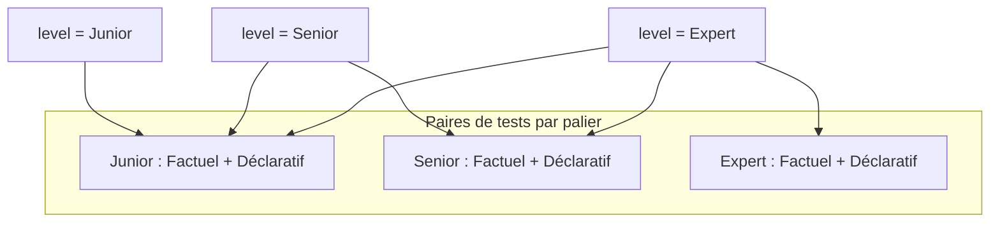
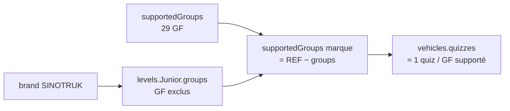
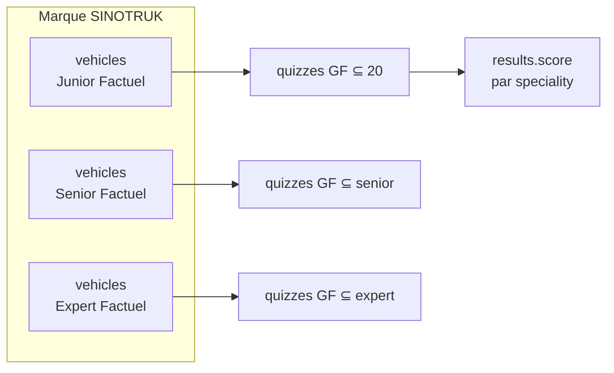
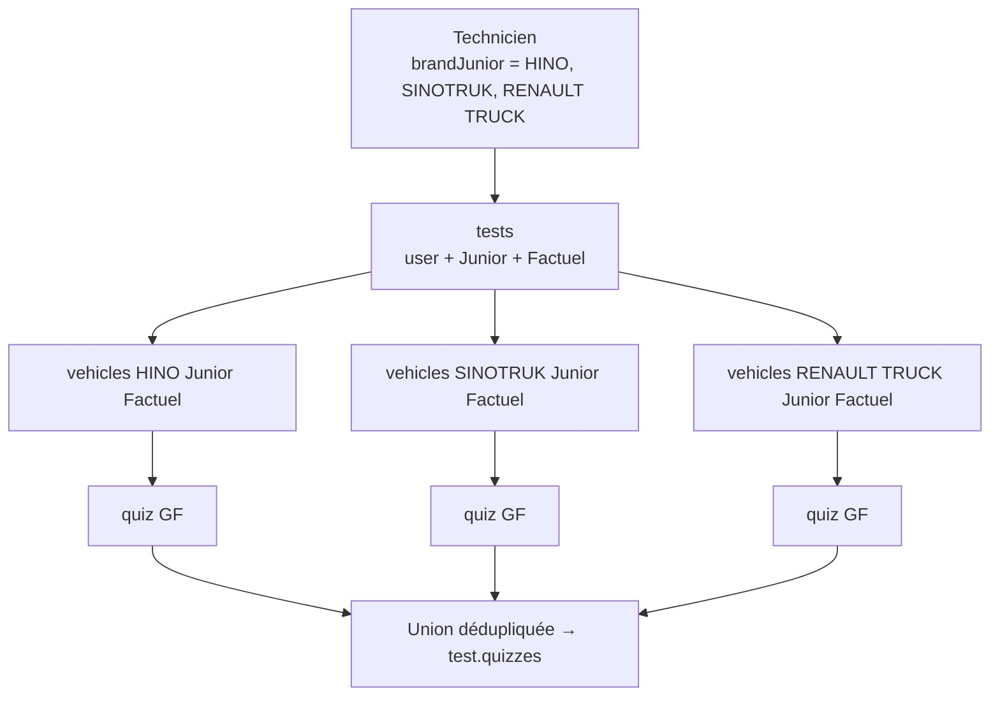
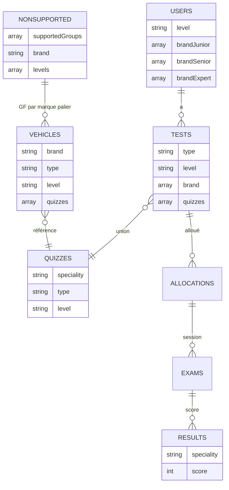
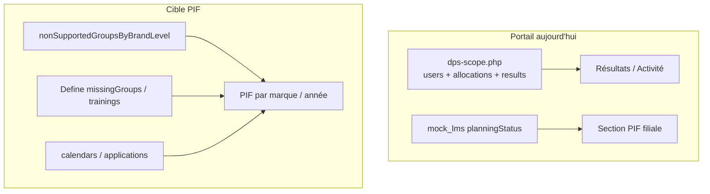

# MEDACAP — modèle compétence technicien (contexte BD)

Document de référence pour le portail CFAO Academy ↔ API `views/measure/api/`.  
Complète [`dps-competency-tier-visual.md`](./dps-competency-tier-visual.md) (couleurs UI) avec la **logique métier Mongo**.

> **Inventaire complet des collections** : [`medacap-mongo-collections.md`](./medacap-mongo-collections.md) — qui travaille avec qui, définitions, comptages.

---

## 1. Vocabulaire

| Terme UI portail | Champ Mongo utilisateur | Niveau test MEDACAP | Périmètre métier |
|------------------|---------------------------|---------------------|------------------|
| **Maintenance** | `brandJunior` | `Junior` | Connaissances / tâches de base |
| **Réparation** | `brandSenior` | `Senior` | Montée en complexité |
| **Diagnostic** | `brandExpert` | `Expert` | Expertise avancée |

| Type test | Code Mongo | Portail | Sens |
|-----------|------------|---------|------|
| Connaissances | `Factuel` | `modality: theory` | QCM théorique |
| Tâches pro. | `Declaratif` | `modality: practical` | Maîtrise déclarative (+ validation manager) |

> En UI MEDACAP : **Groupe fonctionnel** = **Spécialité** (`speciality` sur quiz / questions / résultats).

---

## 2. Technicien : marques par palier

Un technicien **n’a pas une seule liste de marques** : il a **jusqu’à 3 listes**, une par palier.

```text
users {
  level: "Junior" | "Senior" | "Expert",   // palier global du technicien
  brandJunior:  ["HINO", "SINOTRUK", ...], // marques maintenance
  brandSenior:  ["HINO", ...],             // marques réparation (souvent ⊂ ou ≠ junior)
  brandExpert:  ["HINO", ...],             // marques diagnostic (souvent plus restreint)
}
```

### Règles observées en BD (filiale Cameroun Equipment)

1. **Plus le palier monte, moins il y a de marques** — un expert peut avoir 5 marques en `brandJunior`, 4 en `brandSenior`, 2 en `brandExpert`.
2. **Si `level === Expert`**, les trois champs `brandJunior` / `brandSenior` / `brandExpert` sont en général **tous renseignés** : on ne peut pas être expert sans avoir parcouru les paliers inférieurs.
3. Les tableaux peuvent contenir des **chaînes vides** (`""`) — vestige de formulaires à slots fixes ; filtrer en code.

### Exemple réel — `an52ng` (Junior)

| Champ | Valeurs non vides |
|-------|-------------------|
| `brandJunior` | HINO, KING LONG, RENAULT TRUCK, SINOTRUK |
| `brandSenior` | *(vide)* |
| `brandExpert` | *(vide)* |

### Exemple réel — expert `vi21ib`

Les 3 paliers listent les mêmes 5 marques (HINO, KING LONG, RENAULT TRUCK, SINOTRUK, TOYOTA FORKLIFT).

---

## 3. Niveau technicien → batteries de tests à passer

Le champ `users.level` fixe **combien de paires de tests** (Factuel + Déclaratif) le technicien doit réaliser — **y compris les paliers inférieurs**.

| `users.level` | Tests à passer |
|---------------|----------------|
| **Junior** | Junior (Factuel + Déclaratif) |
| **Senior** | Junior **+** Senior |
| **Expert** | Junior **+** Senior **+** Expert |

Source : textes d’aide MEDACAP (`test_junior_info`, `test_senior_info`, `test_expert_info` dans `views/measure/includes/language.php`) et grille `bilanTestNotes.php` (colonnes grisées si `userLevelN` insuffisant).



---

## 4. Groupes fonctionnels (GF / spécialités)

### Référence — 29 GF

| Source | Détail |
|--------|--------|
| **Code PHP** | `QuizConstants::$SPECIALTIES` (`userQuizDeclaratif.php`) — **29 entrées** |
| **Mongo** | Document global dans `nonSupportedGroupsByBrandLevel` → champ `supportedGroups` (**29 noms**) |
| **Config Define** | `views/define/configGF.php` → `functionalGroupsByLevel` (liste par palier Junior / Senior / Expert) |

Libellés types : Assistance à la Conduite, Arbre de Transmission, Boîtes (plusieurs variantes), Climatisation, Direction, Électricité, Freinages (plusieurs), Hydraulique, Moteurs (plusieurs), Réseaux de Communication, Pont, Pneumatique, Réducteur, Suspensions (plusieurs), Transversale.

> Variantes en `quizzes.speciality` : ~31 libellés actifs (doublons « Boite » / « Boîte », + « Carrosserie & Peinture » hors référentiel).

### Collection `nonSupportedGroupsByBrandLevel`

**Nom exact** en base `academy` — **pas** une collection « functional group » générique.

Contenu typique (**16 documents** en local) :

| Document | Structure |
|----------|-----------|
| **1 doc référentiel** | `{ supportedGroups: [ ...29 GF... ] }` |
| **1 doc par marque** | `{ brand: "SINOTRUK", levels: [ ... ] }` |

Par marque, **3 blocs** `levels[]` (Junior, Senior, Expert) :

```json
{
  "brand": "RENAULT TRUCK",
  "levels": [
    {
      "level": "Junior",
      "groups": ["Moteur Essence", "Boite de Vitesse Automatique", "..."],
      "supportedGroups": ["Moteur Diesel", "Freinage", "Arbre de Transmission", "..."]
    },
  ]
}
```

| Champ | Sens |
|-------|------|
| `groups` | GF **non supportés** par la marque à ce palier (hors périmètre technique) |
| `supportedGroups` | GF **évaluables** = référentiel 29 − `groups` (calculé à l’import / refresh) |

**Usage MEDACAP Define** : recommandations formation, couverture besoins, pénalisation scores (`PenalisationHelper.php`, `trainingFunctions.php`, `listBrandGroups.php`).  
**Fallback fichier** : `configGF.php` → `nonSupportedGroupsByBrand` (ancienne config statique par marque).



### Autres collections `academy`

| Collection | Rôle |
|------------|------|
| `specialities` | Référentiel explore (16 docs locaux — doublons / variantes) |
| `quizzes` | Banque QCM ; `speciality`, `type`, `level`, `questions` |
| `questions` | Items QCM ; champ `speciality` |
| `vehicles` | **Pont marque × palier × type → `quizzes[]`** |
| `tests` | Test **personnalisé** technicien (union quiz de ses marques) |
| `allocations` | Lien `user` ↔ `test` (`activeTest`, `activeManager`…) |
| `exams` | Session QCM en cours / terminée |
| `results` | Scores par `user`, `test`, **`speciality`**, `level`, `type` |

---

## 5. Marque → groupes fonctionnels → quiz (`vehicles`)

Chaque document `vehicles` = **1 marque + 1 palier + 1 type** (pas « une marque » au sens unique).

```text
vehicles {
  brand: "SINOTRUK",       // string majuscules
  type: "Factuel",         // ou "Declaratif"
  level: "Junior",         // Junior | Senior | Expert
  label: "Camions",        // libellé métier
  quizzes: [ ObjectId, ... ],
  total: 20,
  active: true,
  created: "dd-mm-YYYY HH:mm:ss",
  updated: "..."           // optionnel
}
```

Les `quizzes[]` référencent la banque `quizzes` ; chaque quiz porte un `speciality` (GF).  
**SINOTRUK · Junior · Factuel** (local) : **20 quiz** → **20 GF** supportés à ce palier.

La liste des GF d’une marque à un palier = **`supportedGroups`** dans `nonSupportedGroupsByBrandLevel`, matérialisée en quiz via `vehicles` + import véhicule (`createVehicle.php`).



Les **moyennes par marque et par palier** dans Define / portail DPS s’appuient sur cette granularité **GF** dans `results`, puis agrégation par marque.

---

## 6. Construction d’un test technicien (union multimarque)

Quand les marques d’un palier sont enregistrées (`_users-logic.php` → `updateTestQuizzes`) :

```php
// Pour chaque marque M dans brandJunior (ou Senior / Expert) :
//   vehicle = vehicles.findOne({ brand: M, type, level, active: true })
//   test.quizzes = UNION(vehicle.quizzes)   // $addToSet
```

Un **même test** est donc :

- **multimarque** : toutes les marques du palier concerné ;
- **mono-palier** : un document `tests` par (`user`, `type`, `level`) ;
- **bi-type** : Factuel et Déclaratif séparés.



Exemple `an52ng` : test Junior Factuel avec **4 marques** → **21 quiz** au total (union des GF communs et spécifiques).

---

## 7. API portail — ce qui est bouclé (et ce qui ne l’est pas)

### `dps-scope.php` — pas une boucle sur les 29 GF

Paramètre `insights=0` : périmètre filiale rapide (~0,3 s).  
Paramètre `insights=1` (défaut) : agrégation complète (~45 s en local — optimisable).

> **Cache portail** : session React (immédiat) + cible Mongo `portalDpsInsights` avec refresh manuel — voir [`portal-dps-insights-cache.md`](./portal-dps-insights-cache.md).

```text
Étape A — 1 requête
  users.find({ subsidiary, department, profile: Technicien })
  → liste technicians[] (nom, agence, primaryTier, brands)

Étape B — si insights=1, pour CHAQUE technicien (ex. 27)
  pour CHAQUE couple (type × level)  → 6 slots
    type ∈ [Factuel, Declaratif]
    level ∈ [Junior, Senior, Expert]
      allocations.findOne({ user, type, level })
      exams.findOne × 2
      results.findOne × 2
  → collaboratorEvaluations[], brandStats, recentLogs
```

| Boucle | Itérations typiques | Collections lues |
|--------|---------------------|------------------|
| Techniciens filiale | 27 | `users` |
| Slots test / technicien | 6 | `allocations`, `exams`, `results` |
| **Total requêtes** | **~27 × 6 × 4 ≈ 650** | Pas `vehicles`, pas `nonSupportedGroupsByBrandLevel` |

### Collections **non** lues par l’API portail actuelle

| Collection | Utilisée par |
|------------|--------------|
| `nonSupportedGroupsByBrandLevel` | Define (PIF, couverture, recommandations) |
| `vehicles` | Création tests (`updateTestQuizzes`), Explore |
| `tests` | Indirectement via `allocations.test` |

### `evaluations.php` (apprenant)

Même fonction `portalApiUserCompetencyEvaluations()` — **1 technicien**, 6 slots, pas de boucle filiale.

---

## 8. Chaîne complète mesure → portail

```text
1. Admin renseigne brandJunior / brandSenior / brandExpert
2. updateTestQuizzes régénère tests (union vehicles)
3. allocations expose les tests au technicien (+ manager pour Déclaratif)
4. exams + results stockent scores par speciality
5. API portal (evaluations.php, dps-scope.php) agrège pour le portail React
```

### Mapping portail React

| MEDACAP | Portail |
|---------|---------|
| `brandJunior` / `Senior` / `Expert` | Filtres Maintenance / Réparation / Diagnostic |
| `Factuel` | `modality: theory` |
| `Declaratif` | `modality: practical` |
| `users.level` | PIF / certifs (hors scope API actuel) |

### Attribution scores par marque (filiale DPS)

Un test Junior d’un technicien multi-marques doit être **compté sur chaque marque de `brandJunior`**, pas seulement la première.  
Implémenté dans `bootstrap.php` → `portalApiBrandSlugsForTier()` + agrégation `portalApiDpsAggregateBrandStats()`.

---

## 9. Schéma récapitulatif



---

## 10. Portail CFAO Academy — état actuel vs cible GF

### Branché sur Mongo (API)

| Section DPS | Source | Notes |
|-------------|--------|-------|
| Collaborateurs | `dps-scope` → `technicians[]` | Live |
| Résultats / scores marque | `brandStats`, `collaboratorEvaluations` | Live ; attribution multi-marque par palier |
| Activité | `recentLogs` | Live |
| Chargement | 2 phases `insights=0` puis `1` | PIF affiché sans attendre insights |

### Encore mock (`mock_lms.js` u10)

| Section | Champ mock | Cible BD |
|---------|------------|----------|
| **Plans formation (PIF)** | `planningStatus`, `planPathway` | Define / calendrier / allocations formation |
| KPI PIF proposés/validés | `brandStats.pifProposed`, `pifValidated` | Define recommandations |
| Alertes navbar | `alerts` | Règles métier filiale |
| Tickets assistance | `filialeTickets` | Module assistance |

### Cible PIF filiale (logique GF)

Pour remplacer le mock PIF :

1. Lire **besoins** depuis Define (`missingGroups`, formations recommandées) ou calendrier MEDACAP.
2. Pour chaque technicien × marque × palier : GF applicables = `supportedGroups` (`nonSupportedGroupsByBrandLevel`) ∩ marques du technicien (`brandJunior` / etc.).
3. Croiser avec **sessions planifiées** (catalogue CFAO + statuts inscription).
4. **Ne pas** réutiliser la boucle `dps-scope` insights — domaine formation ≠ mesure compétence.



### Règles d’implémentation portail

1. **Filtre palier résultats** = `competencyTier` + marques du champ BD (`brandJunior` ↔ junior, etc.).
2. **Moyenne marque** (actuel) = attribuer chaque test du palier à **toutes** les marques du technicien à ce palier (`portalApiBrandSlugsForTier`).
3. **Moyenne marque** (futur précis) = pondérer par `results.speciality` ∩ GF supportés de la marque au palier.
4. **Normaliser** les tableaux `brand*` (retirer `""`) avant comptage.
5. **Ne pas bloquer l’UI** sur `insights=1` pour les sections encore mockées (PIF).

---

## 11. Fichiers MEDACAP utiles

| Sujet | Fichier |
|-------|---------|
| GF supportés / exclus par marque | `views/define/listBrandGroups.php`, `importBrandGroups.php` |
| Config GF statique | `views/define/configGF.php` |
| Recommandations PIF | `views/define/trainingFunctions.php`, `TrainingRecommendation.php` |
| Création `vehicles` | `views/explore/createVehicle.php` |
| Liste 29 GF (code) | `views/measure/userQuizDeclaratif.php` → `QuizConstants::$SPECIALTIES` |
| Régénération tests | `views/measure/_users-logic.php` → `updateTestQuizzes()` |
| API portail | `views/measure/api/bootstrap.php`, `evaluations.php`, `dps-scope.php` |

---

*Dernière vérification BD : juin 2026 — Mongo `academy` local `127.0.0.1:27017`, filiale Equipment Cameroun.*
