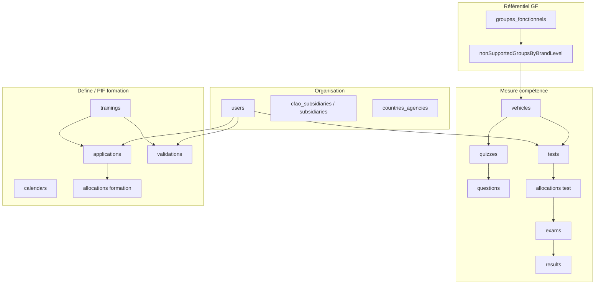

# MEDACAP — inventaire collections MongoDB (`academy`)

Référence **exhaustive** de la base locale `mongodb://127.0.0.1:27017/academy` (comptages juin 2026).  
Complète [`medacap-competency-model.md`](./medacap-competency-model.md) (logique métier GF / tests / portail).

---

## Vue d’ensemble — 4 domaines

| Domaine | Collections | Rôle |
|---------|-------------|------|
| **Organisation** | `users`, filiales, agences, profils | Qui est qui, où, avec quelles marques |
| **Mesure** | `tests`, `allocations`, `exams`, `results`, `quizzes`… | QCM compétence (Factuel / Déclaratif) |
| **GF** | `groupes_fonctionnels`, `nonSupportedGroupsByBrandLevel` | 29 groupes fonctionnels, exclusions par marque/palier |
| **Define / PIF** | `trainings`, `applications`, `validations`, `calendars` | Plan de formation, inscriptions, validation manager |
| **Agrégats** | `technicianScores`, `reports_subsidiary_results`… | Cache / reporting pré-calculé |
| **Système** | `profiles`, `functionalities`, `logs`… | RBAC, audit, technique |

---

## 1. Organisation & utilisateurs

### `users` (489)

**Définition** : comptes MEDACAP (techniciens, managers, admins, directeurs).

| Champs clés | Rôle |
|-------------|------|
| `profile` | `Technicien`, `Manager`, `Admin`, etc. |
| `level` | Palier global : `Junior` \| `Senior` \| `Expert` |
| `brandJunior` / `brandSenior` / `brandExpert` | Marques par palier (maintenance / réparation / diagnostic) |
| `subsidiary`, `agency`, `country`, `department` | Périmètre filiale |
| `manager` | ObjectId manager (technicien) |
| `users` | Liste techniciens (manager) |
| `active` | Compte actif |

**Travaille avec** : `tests`, `allocations`, `exams`, `results`, `applications`, `validations`, `connections`, `calendars`.

**Portail** : `dps-scope.php`, `evaluations.php`, `portal-launch.php` lisent `users`.

---

### `cfao_subsidiaries` (12) · `subsidiaries` (12) · `countries_agencies` (13)

**Définition** : référentiel géographique — pays, filiales CFAO, agences.

| Collection | Champs typiques |
|------------|-----------------|
| `cfao_subsidiaries` | `country`, `subsidiary`, `agencies[]`, `flagPath` |
| `subsidiaries` | `name`, `agencies`, compteurs managers |
| `countries_agencies` | `country`, `subsidiary`, `agencies[]` |

**Pourquoi** : filtrage dashboards, alias filiales (`dps-scope` → `subsidiaryAliases.php`).

---

### `connections` (313)

Sessions / connexions utilisateur (`user`, `start`, `end`, `status`, `active`).

---

### `managersBySubsidiaryAgency` (11) · `managersTechniciens` (30)

Vues / agrégats organisationnels : managers par filiale-agence, effectifs techniciens par manager.

---

## 2. Référentiel groupes fonctionnels (GF)

### `groupes_fonctionnels` (29)

**Définition** : catalogue canonique des **29 GF** (un document par GF).

| Champ | Exemple |
|-------|---------|
| `name` | `Moteur Diesel` |
| `slug` | identifiant court |
| `isActive` | bool |
| `createdAt` | date |

**Relation** : alimente la liste `supportedGroups` dans `nonSupportedGroupsByBrandLevel` ; nom = `quizzes.speciality` / `results.speciality`.

---

### `nonSupportedGroupsByBrandLevel` (16)

**Définition** : pour chaque **marque**, quels GF sont **exclus** par palier (le reste = supportés).

| Document | Structure |
|----------|-----------|
| Référentiel global | `{ supportedGroups: [29 noms] }` |
| Par marque | `{ brand: "SINOTRUK", levels: [{ level, groups[], supportedGroups[] }] }` |

- `groups` = GF **non** applicables à la marque à ce palier  
- `supportedGroups` = GF **évaluables** (29 − exclusions)

**Travaille avec** : `vehicles` (quiz par GF supporté), Define (`trainingFunctions.php`, `coverageCalculator.php`, `PenalisationHelper.php`).

**Portail** : **non lu** aujourd’hui.

---

### `specialities` (16)

Ancien / parallèle au pont marque→quiz dans Explore : documents par type/niveau avec `quizzes[]`. Moins utilisé que `vehicles` pour Equipment.

---

## 3. Mesure compétence (module Measure)

Chaîne : **véhicule/marque → quiz → test technicien → allocation → examen → résultat**.

### `quizzes` (136)

**Définition** : banque de QCM par GF.

| Champ | Valeurs |
|-------|---------|
| `speciality` | Nom GF (`Arbre de Transmission`, …) |
| `type` | `Factuel` \| `Declaratif` |
| `level` | `Junior` \| `Senior` \| `Expert` |
| `questions` | ObjectId[] → `questions` |
| `total` | nb questions |
| `active` | bool |

---

### `questions` (1176)

**Définition** : énoncés QCM.

| Champ | Rôle |
|-------|------|
| `speciality` | GF concerné |
| `level` | palier |
| `label`, `proposal1…4`, `answer` | énoncé + réponses |
| `type` | factuel / déclaratif (selon contexte) |

---

### `vehicles` (120)

**Définition** : **configuration marque × palier × type** → liste de quiz GF couverts.

| Champ | Exemple |
|-------|---------|
| `brand` | `SINOTRUK` |
| `level` | `Junior` |
| `type` | `Factuel` |
| `label` | `Camions` |
| `quizzes` | ObjectId[] (≈ 1 par GF supporté) |
| `total` | count quizzes |

**Pourquoi** : matérialise `supportedGroups` en quiz concrets ; `updateTestQuizzes()` unionne les `vehicles` des marques du technicien.

---

### `tests` (1017)

**Définition** : **test personnalisé** d’un technicien (union multimarque par palier + type).

| Champ | Rôle |
|-------|------|
| `user` | ObjectId technicien |
| `brand` | string[] marques du palier |
| `type` | `Factuel` \| `Declaratif` |
| `level` | `Junior` \| `Senior` \| `Expert` |
| `quizzes` | union ObjectId depuis `vehicles` |
| `total` | nb quiz |
| `active` | bool |

**Création** : `_users-logic.php` → `updateTestQuizzes()` quand `brandJunior` / etc. changent.

---

### `allocations` (5175) — **double usage**

**Définition** : lien **utilisateur ↔ ressource à passer**, avec flags d’activation.

#### A. Mesure compétence (portail lit ça)

| Champ | Rôle |
|-------|------|
| `user` | technicien |
| `test` | ObjectId → `tests` |
| `type` | `Factuel` \| `Declaratif` |
| `level` | `Junior` \| `Senior` \| `Expert` |
| `active` | allocation existe |
| `activeTest` | QCM technicien ouvert |
| `activeManager` | QCM manager (déclaratif) |

#### B. Define / formation PIF

| Champ | Rôle |
|-------|------|
| `user` | technicien |
| `training` | ObjectId → `trainings` |
| `active` | inscription confirmée |

**Attention** : même collection, documents différents selon présence de `test` ou `training`.

---

### `exams` (1391)

**Définition** : **session QCM en cours ou terminée**.

| Champ | Rôle |
|-------|------|
| `user`, `test` | qui, quel test |
| `manager` | si évaluation manager |
| `type` | `Technicien` \| `Manager` \| … |
| `active` | session ouverte |
| `questions`, `answers` | progression |
| `quiz*` | refs quiz par GF (clés dynamiques) |
| `hour`, `minute` | durée |

---

### `results` (30591)

**Définition** : **score validé** par GF / test / palier.

| Champ | Rôle |
|-------|------|
| `user`, `test` | technicien + test |
| `speciality` | **GF** noté |
| `level`, `type`, `typeR` | palier + Factuel/Déclaratif |
| `score` | % |
| `numberTest` | tentative |
| `created` | horodatage |

**Pourquoi** : granularité **GF** — base des moyennes par marque dans Define ; portail agrège via `portalApiUserCompetencyEvaluations()`.

---

### `papers` (6) · `orientation_questions` (10)

Épreuves figées (candidats Cameroun) et questions d’orientation — hors flux technicien Equipment standard.

---

### `seuils` (2)

Seuils de réussite QCM par palier (`qcmJunior`, `tacheSenior`, etc.) — règles de validation.

---

## 4. Define — formations & PIF

### `trainings` (158)

**Définition** : **catalogue sessions formation** (présentiel / distanciel).

| Champ | Rôle |
|-------|------|
| `code`, `label` | identifiant catalogue |
| `brand` | marque |
| `level` | palier visé |
| `type` | type formation |
| `specialities` | GF couverts par la session |
| `startDates`, `endDates`, `places` | planning |
| `trainer`, `duration`, `link` | logistique |
| `users` | inscrits |
| `active` | bool |

**Travaille avec** : `applications`, `validations`, `allocations` (formation), `calendars`.

**Portail PIF mock** : `planningStatus` / `planPathway` simulent ce que devrait fournir cette couche + `applications`.

---

### `applications` (1)

**Définition** : **demande d’inscription** technicien → formation.

| Champ | Rôle |
|-------|------|
| `user`, `training` | qui, quelle formation |
| `manager` | valideur |
| `status` | workflow (`Confirmed`, …) |
| `year`, `period`, `place` | contexte |
| `active` | bool |

**Flux** : confirmation → `allocations` formation `active: true`.

---

### `validations` (444)

**Définition** : **validation manager** d’une formation suivie.

| Champ | Rôle |
|-------|------|
| `user`, `training`, `manager` | triplet |
| `status` | état validation |
| `active`, `created` | métadonnées |

---

### `calendars` (14)

Événements calendrier (sessions, dates, lieux) — lien affichage planning.

---

### `objectives` (via `defineObjectives.php`)

Objectifs formation par période — pilotage Define.

---

## 5. Agrégats & reporting (cache)

| Collection | Docs | Rôle |
|------------|------|------|
| `technicianScores` | 177 | Scores synthèse par technicien / paliers |
| `technicianBrandScores` | 194 | Scores par marque |
| `subsidiaryTrainingSummary` | 9 | Synthèse formations par filiale |
| `allManagersTrainingStats` | 34 | Stats managers |
| `reports_subsidiary_results` | 86 | Rapports filiale pré-générés |
| `agency_cleanup_results` | 1 | Nettoyage données agences |

**Pourquoi** : éviter de recalculer à chaque dashboard ; **pas** utilisés par l’API portail React actuelle.

---

## 6. RBAC & administration

### `profiles` (12)

Profils métier (`name`, `functionalities[]`, `icon`).

### `functionalities` (84)

Fonctionnalités menu / droits (`key`, `modules`, `group`, `name`).

**Relation** : `profiles.functionalities` → contrôle accès modules Measure / Define / Explore.

### `admin_tokens` (5) · `deployments` (1)

Tokens admin ponctuels ; suivi déploiements.

---

## 7. Module Commercial (hors Equipment)

| Collection | Docs | Rôle |
|------------|------|------|
| `commercials` | 8 | Commerciaux |
| `commercial_admins` | 3 | Admins questionnaire |
| `commercial_responses` | 7 | Réponses questionnaire |
| `commercial_corrections` | 3 | Corrections / notes |

Domaine séparé du portail technicien Equipment.

---

## 8. Système & technique

| Collection | Docs | Rôle |
|------------|------|------|
| `logs` | 20879 | Journal applicatif (time-series) |
| `system.buckets.logs` | 1287 | Bucket interne Mongo logs |
| `chats` | 12 | Messages support QCM |
| `test` / `testProgress` / `test_collection` | 0–2 | Tests techniques / dev |

---

## 9. Matrice « qui travaille avec qui »

| De → Vers | Lien | Pourquoi |
|-----------|------|----------|
| `users.brand*` → `tests` | `updateTestQuizzes` | Union quiz des marques du palier |
| `vehicles` → `quizzes` | `quizzes[]` | GF supportés par marque/palier/type |
| `quizzes` → `questions` | `questions[]` | Contenu QCM |
| `tests` → `allocations` | `test` | Exposer le test au technicien |
| `allocations` → `exams` | même `user`+`test` | Session en cours |
| `exams` → `results` | validation | Score par `speciality` |
| `groupes_fonctionnels` → `nonSupported…` | liste 29 | Référentiel GF |
| `nonSupported…` → `vehicles` | indirect | GF supportés → quiz |
| `trainings` → `applications` | `training` | Inscription |
| `applications` → `allocations` | `training` | Inscription confirmée |
| `trainings` → `validations` | `training` | Validation manager |
| `results` → agrégats | batch jobs | Dashboards Define |

---

## 10. API portail React — routes

| Endpoint | Collections | Rôle |
|----------|-------------|------|
| `dps-scope.php?insights=0&pif=0` | `users` | Périmètre filiale rapide (~0,3 s) |
| `dps-insights.php` | `users`, `allocations`, `exams`, `results` | Résultats + activité filiale |
| `dps-pif.php` | `users`, `allocations`, `trainings`, `validations`, `applications` | PIF filiale (`planningStatus`, `brandPifStats`) |
| `evaluations.php` | `users`, `allocations`, `exams`, `results` | Tests compétence apprenant |
| `learner-pif.php` | idem PIF, 1 technicien | PIF apprenant |
| `portal-launch.php` | `users` | Session QCM |
| `portal-launch-define.php` | `users` | SSO → Define |
| `find-technician.php` | `users` | Recherche techniciens (debug) |

Paramètres communs : `key`, `userId` \| `username` \| `email`.

**Non lues par le portail** : agrégats cache, `calendars` (direct), `nonSupportedGroupsByBrandLevel`.

---

## 11. PIF portail — collections cibles

Pour remplacer le mock `planningStatus` :

| Besoin UI | Collection(s) |
|-----------|---------------|
| Catalogue sessions | `trainings` |
| Inscriptions | `applications` + `allocations` (formation) |
| Validation manager | `validations` |
| Dates / lieux | `calendars`, champs `startDates` / `places` |
| GF couverts | `trainings.specialities` ∩ `nonSupportedGroupsByBrandLevel` |

---

*Inventaire généré depuis Mongo local + code MEDACAP (`views/measure`, `views/define`, `views/explore`). Comptages : juin 2026.*
