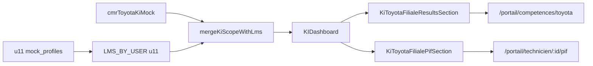

# Portail Key Instructor — André YOGBA (Toyota Cameroun)

Plan de montée du portail KI pilote dans `frontend/`, persona **André YOGBA** — Key Instructor Toyota, Douala (liste officielle `_archive/data/ki.json`).

> **Distinction métier** : Eugène EBENE et les formateurs du pôle Toyota (`equipe-poles.json`) sont des **`trainer`** (experts Academy). André YOGBA est un **`ki`** — technicien filiale certifié G2/Diagnostic, relais terrain.

---

## 1. Périmètre fonctionnel

### Casquette instructeur (Toyota × filiale Cameroun)

| Besoin | Section portail | Source données v1 | Source v2 |
|--------|-----------------|-------------------|-----------|
| Bilan KI | `#bilan` | `kiResults`, KPI filiale Toyota | API `ki-scope.php` |
| Sessions à animer | `#fad` | `formationsADispenser` | Planning LMS / Define |
| Résultats techniciens Toyota | `#toyota-resultats` | `brandStats` + `collaboratorEvaluations` | MEDACAP Motors GF |
| PIF techniciens Toyota | `#toyota-pif` | `pifTechnicians` filtrés Toyota | Export PIF filiale |
| Fiche PIF technicien | `/portail/technicien/:id/pif` | Réutilisation page existante | Idem DPS |

### Casquette apprenant (parcours personnel André)

| Besoin | Section | Source |
|--------|---------|--------|
| Tests compétence | `#parcours` → tests | `evaluations` |
| Mon PIF | `#parcours` → plan | `planPathway`, `planningStatus` |
| Mes sessions à suivre | `#parcours` | `assignedTrainings` |
| Certifications | `#certifs` | `certifications` |

**Règle scope** : le KI ne voit que **sa marque instructeur** (`instructorBrands: ['toyota']`) et **sa filiale** — pas les autres marques Motors de la filiale.

---

## 2. Persona demo

```json
{
  "id": "u11",
  "roles": ["learner", "ki"],
  "firstName": "André",
  "lastName": "YOGBA",
  "demoLabel": "André YOGBA — KI Toyota Cameroun",
  "filiale": "CFAO MOTORS Cameroun",
  "pays": "Cameroun",
  "orgLabel": "Douala",
  "departments": ["motors"],
  "brands": ["toyota"],
  "instructorBrands": ["toyota"],
  "certLevels": { "toyota": "G2" },
  "kiNetworkId": 1
}
```

---

## 3. Architecture frontend

```
frontend/src/
├── data/
│   ├── ki-network.json              # 17 KI Toyota (liste officielle)
│   └── ki/cmrToyotaKiMock.js        # Scope filiale Toyota CM (mock)
├── utils/kiScope.js                 # mergeKiScopeWithLms, filtres marque
├── components/
│   ├── KiToyotaFilialeResultsSection.jsx
│   └── KiToyotaFilialePifSection.jsx
└── pages/portal/KIDashboard.jsx     # Dashboard restructuré
```

### Flux données



---

## 4. Navigation portail (`PORTAL_NAV_SECTIONS.ki`)

| Ordre | Clé | Ancre | Libellé |
|-------|-----|-------|---------|
| 1 | bilan | `#bilan` | Vue d'ensemble |
| 2 | fad | `#fad` | Sessions à animer |
| 3 | toyota-resultats | `#toyota-resultats` | Toyota — résultats |
| 4 | toyota-pif | `#toyota-pif` | Toyota — PIF |
| 5 | parcours | `#parcours` | Votre parcours |

---

## 5. Phases d'exécution

### Phase 1 — Fondations (cette livraison)

  /** Phase 1 — exécutée */
- [x] Plan MD (ce document)
- [x] `ki-network.json` dans `frontend/src/data/`
- [x] Profil `u11` + mock LMS André YOGBA
- [x] `kiScope.js` + mock filiale Toyota CM
- [x] Nav KI + i18n FR
- [x] `KIDashboard` restructuré + sections Toyota filiale
- [x] Réutilisation `DpsCollaboratorResultsSection` / `DpsFilialePifSection` via filtres

### Phase 2 — Données réalistes

- [ ] Croiser `sessions-2026.json` pour sessions KI terrain (co-animation filiale)
- [ ] Enrichir roster techniciens Toyota CM (noms agences réels)
- [ ] Scores GF cohérents par palier G4→G1

### Phase 3 — API live

- [ ] `ki-scope.php` (miroir `dps-scope.php`, Motors, 1 marque instructeur)
- [ ] Hook `useKiFilialeScope.js` (miroir `useDpsFilialeScope.js`)
- [ ] Brancher MEDACAP si techniciens Motors CM en base

### Phase 4 — Landing & réseau

- [ ] Afficher les 17 KI depuis `ki-network.json` dans section Réseau Academy
- [ ] Différencier visuellement KI / PIC / Formateurs experts

### Phase 5 — Portail formateur (`trainer`)

- [ ] Persona Eugène EBENE — sessions multi-filiales, pas vue techniciens filiale
- [ ] Rôle `trainer` distinct du dashboard `ki`

---

## 6. Réutilisation composants DPS

| Composant DPS | Usage KI |
|---------------|----------|
| `DpsCollaboratorResultsSection` | Carte unique Toyota (`user.brands = ['toyota']`) |
| `DpsBrandCompetencyDetail` | Détail marque via `/portail/competences/toyota` |
| `DpsFilialePifSection` | Liste PIF filtrée techniciens Toyota |
| `DpsTechnicianPifDetail` | Fiche PIF inchangée |
| `KiHeroCard` | Prochaine session à animer + stats KI |

---

## 7. Critères d'acceptation Phase 1

1. Login demo **André YOGBA — KI Toyota Cameroun** (`u11`)
2. Nav 5 sections fonctionnelles (scroll ancres)
3. Section résultats : carte Toyota avec score + lien détail marque
4. Section PIF : ≥ 6 techniciens Toyota CM groupés par palier
5. Section FAD : ≥ 2 sessions à animer
6. Section parcours : tests + plan + certifs personnels André
7. Liste `ki-network.json` exportée pour usage landing (Phase 4)

---

## 8. Références

| Fichier | Rôle |
|---------|------|
| `_archive/data/ki.json` | Liste officielle 17 KI |
| `PLATFORM_ROLES.md` §2.1 vs §2.2 | KI vs Formateur |
| `frontend/src/data/academy/reseau.json` | Copy landing 18 KI |
| `frontend/src/data/academy/equipe-poles.json` | Formateurs Academy (≠ KI) |
| `docs/medacap-competency-model.md` | Scores GF Motors |
