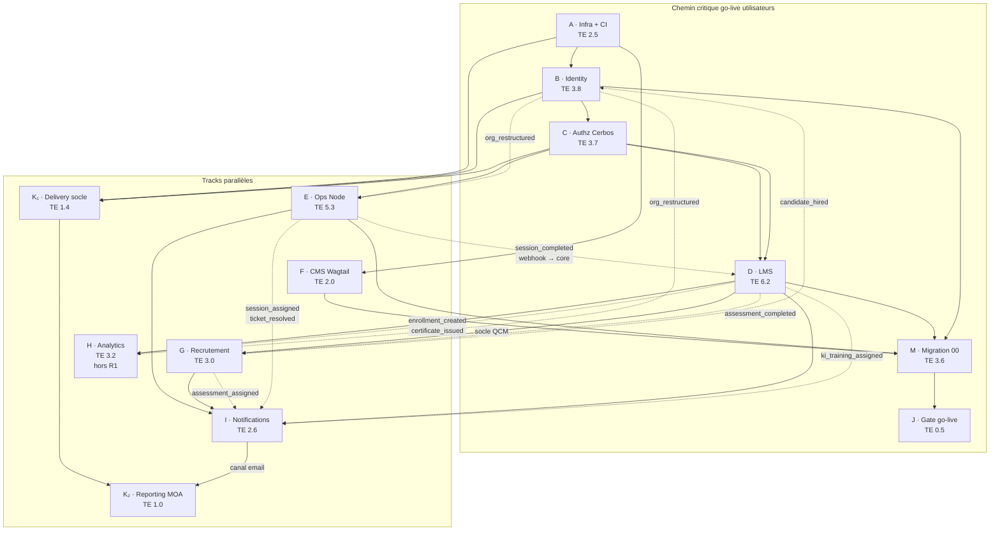

# CFAO Academy — Planification build (PERT)

Complément à `architecture.md` (§5.4 événements, §5.4 bis Git) et `backlog.md` (epics 00–15).  
Estimations **TE** = `(O + 4M + P) / 6` en semaines-personne — triplets **O/M/P** en annexe §2 ; TE affichées incluent la séquence tests TU→TI→contrat→E2E (§6).

---

## 1. Graphe PERT — build & go-live *(v2)*



**Légende**

| Style | Signification |
|-------|----------------|
| Flèche pleine | Dépendance de livraison (fin de tâche → début tâche) |
| Flèche pointillée | **Webhook / événement inter-services** (cf. §3) |
| Chemin **A→B→C→D→M→J** | Chemin critique **release 1 utilisateurs** (~**20,3 sem.** TE cumulées) |
| **M → J** | Gate **obligatoire** — pas d'accès prod sans migration validée |
| **H, G, K₂** | **Hors chemin critique R1** — post go-live ou parallèle MOA |
| **K₁** | Démarre tôt (phase 1) ; **ne bloque pas J** |

### Ce qui a changé (v1 → v2)

| Avant | Après | Raison |
|-------|-------|--------|
| Chemin critique **H → J** | **M → J** | Analytics = release 1.1 ; la gate dépend de la **migration** |
| **K** en fin de phase 3 | **K₁** dès A+B+C ; **K₂** après canal email **I** | Pilotage utile **pendant** le build ; mails MOA après socle notifications |
| TE « code seul » | TE **majorées** (~+15–20 %) | Chaque nœud inclut TU→TI→contrat→E2E (§6) |
| **J** conditionné à **H** | **J** conditionné à **M** (+ E si sessions R1) | Critères `00-5` / `00-7` / webhooks staging |

**Parallèle contraignant pour M :** **M** attend **D partiel** + **E partiel** (`00-4`). Comme **D (6,2) > E (5,3)** depuis C, le chemin critique reste **via D**.

---

## 2. Nœuds du graphe

| ID | Module | Epic | TE | Dépendances build | Notes |
|----|--------|------|-----|-------------------|--------|
| **A** | Infra + CI | — | **2,5** | — | Compose, Keycloak, Cerbos, BFF, gateway, 2× Postgres ; **pipeline CI** — *O/M/P : 2,0 / 2,5 / 3,0* |
| **B** | Identity | 11·12 | **3,8** | A | Arbre org, comptes, `role_assignment` — *O/M/P : 3,0 / 3,8 / 4,6* |
| **C** | Authz | T-2·T-3 | **3,7** | B | Policies Cerbos, PEP, `filters.py` — *O/M/P : 2,9 / 3,7 / 4,5* |
| **D** | LMS | 01·02·03 | **6,2** | C | QCM, parcours, KI/PIC ; E2E apprenant — *O/M/P : 4,8 / 6,2 / 7,6* |
| **E** | Ops | 04·05·06·08 | **5,3** | C | Sessions, salles, planning, tickets — *O/M/P : 4,2 / 5,3 / 6,4* |
| **F** | CMS | 13 | **2,0** | A | Wagtail vitrine + blog — *O/M/P : 1,5 / 2,0 / 2,5* |
| **G** | Recrutement | 09 | **3,0** | **D (socle QCM)** | Hors chemin critique R1 — *O/M/P : 2,4 / 3,0 / 3,6* |
| **H** | Analytics | 07·10 | **3,2** | D | Hors chemin critique R1 — *O/M/P : 2,5 / 3,2 / 3,9* |
| **I** | Notifications | 14 | **2,6** | D, E (+ G si phase 2) | Socle ~0,8 + métier ~1,8 — *O/M/P : 2,0 / 2,6 / 3,2* |
| **M** | **Migration** | **00** | **3,6** | B + D partiel + E partiel (+ F) | `00-5`, `00-7` E2E — *O/M/P : 2,8 / 3,6 / 4,4* |
| **J** | **Gate go-live** | **00-8** | **0,5** | **M** + D (+ E si sessions R1) | *O/M/P : 0,3 / 0,5 / 0,7* |
| **K₁** | Delivery socle | 15 | **1,4** | A, B, C | Webhook Git, cockpit — *O/M/P : 1,0 / 1,4 / 1,8* |
| **K₂** | Reporting MOA | 15 | **1,0** | K₁ + I (socle email) | Rappel jeudi, rapport vendredi — *O/M/P : 0,7 / 1,0 / 1,3* |

> **Recrutement ↔ LMS.** G ne démarre qu'après le **socle QCM** de D. Hors périmètre release 1 minimale si MOA valide un MVP sans recrutement.

> **TE cumulée chemin critique R1 :** 2,5 + 3,8 + 3,7 + 6,2 + 3,6 + 0,5 ≈ **20,3 sem.** (1 dev équivalent ; diviser par la taille d'équipe pour le calendrier).

### Matrice « bloque le go-live ? »

| Nœud | Bloque **J** (accès utilisateurs) ? |
|------|-------------------------------------|
| A, B, C, D | **Oui** (socle sécurisé + LMS MVP) |
| E | **Oui** si sessions R1 + webhook `session_completed` dans le périmètre |
| M | **Oui** (migration + smoke `00-7`) |
| F | Partiel (`00-3` articles) — peut être decoupé post-J |
| G, H, K₂ | **Non** (phase 2 / 1.1 / pilotage MOA) |
| K₁ | **Non** (recommandé dès phase 1 pour visibilité build) |
| I (métier complet) | **Non** pour J — **oui** pour K₂ et confort utilisateur (rappels, mails formation) |

### Annexe — triplets O / M / P par nœud *(recalibrage sprint 0)*

Formule : **TE = (O + 4M + P) / 6** (semaines-personne). Les TE du §2 incluent déjà la charge tests TU→TI→contrat→E2E (§6) — les triplets ci-dessous reflètent cette hypothèse **v2**.

| ID | O | M | P | TE calc. | Δ vs v1 TE | Commentaire recalibrage |
|----|---:|---:|---:|---:|---:|-------------------------|
| **A** | 2,0 | 2,5 | 3,0 | **2,5** | +0,3 | Compose, Keycloak, Cerbos, BFF, CI initiale |
| **B** | 3,0 | 3,8 | 4,6 | **3,8** | +0,5 | Arbre org, comptes, scopes, TU/TI identity |
| **C** | 2,9 | 3,7 | 4,5 | **3,7** | +0,5 | Policies Cerbos + `filters.py` + tests policy |
| **D** | 4,8 | 6,2 | 7,6 | **6,2** | +0,9 | QCM, parcours, KI/PIC — plus gros module + E2E |
| **E** | 4,2 | 5,3 | 6,4 | **5,3** | +0,8 | Ops Node + contrat webhook E→D |
| **F** | 1,5 | 2,0 | 2,5 | **2,0** | +0,3 | Wagtail intégré + migration articles |
| **G** | 2,4 | 3,0 | 3,6 | **3,0** | +0,4 | Hors R1 — dépend socle QCM |
| **H** | 2,5 | 3,2 | 3,9 | **3,2** | +0,4 | Hors R1 — read models + dashboards |
| **I** | 2,0 | 2,6 | 3,2 | **2,6** | +0,4 | Dont socle ~0,8 (O 0,6 / M 0,8 / P 1,0) + métier ~1,8 |
| **M** | 2,8 | 3,6 | 4,4 | **3,6** | +0,6 | Lots 00-x + smoke E2E `00-7` |
| **J** | 0,3 | 0,5 | 0,7 | **0,5** | — | Checklist, validation MOA, rollback |
| **K₁** | 1,0 | 1,4 | 1,8 | **1,4** | n/a | Webhook Git, cockpit, backlog |
| **K₂** | 0,7 | 1,0 | 1,3 | **1,0** | n/a | Templates MOA, rappel jeudi, envoi vendredi |

**Procédure après sprint 0**

1. Pour chaque nœud touché, noter le **réalisé** (semaines-personne effectives) et ajuster **M** (nouvelle médiane observée).
2. Recalculer **TE** avec la formule ; si l'écart réalisé/TE > 20 %, élargir l'écart **O–P** (incertitude) plutôt que de ne bouger que M.
3. Recalculer le chemin critique **A→B→C→D→M→J** : somme des TE sur la chaîne (ou `max(D,E)+M+J` si E entre dans le périmètre R1 sessions).
4. Reporter les nouveaux triplets dans ce tableau (versionner `planning.md` ou note de sprint).

**Référence v1** (avant majoration tests + correction chemin critique) — pour historique :

| ID | O v1 | M v1 | P v1 | TE v1 |
|----|-----:|-----:|-----:|------:|
| A | 1,8 | 2,2 | 2,8 | 2,2 |
| B | 2,7 | 3,3 | 4,0 | 3,3 |
| C | 2,6 | 3,2 | 3,9 | 3,2 |
| D | 4,2 | 5,3 | 6,5 | 5,3 |
| E | 3,6 | 4,5 | 5,5 | 4,5 |
| F | 1,3 | 1,7 | 2,1 | 1,7 |
| G | 2,1 | 2,6 | 3,2 | 2,6 |
| H | 2,3 | 2,8 | 3,4 | 2,8 |
| I | 1,7 | 2,2 | 2,7 | 2,2 |
| M | 2,4 | 3,0 | 3,7 | 3,0 |
| J | 0,3 | 0,5 | 0,7 | 0,5 |
| K *(unique)* | 1,6 | 2,0 | 2,5 | 2,0 |

---

## 3. Webhooks & événements sur le graphe

Implémentation initiale : **HTTP webhook direct** (`integration/webhooks.py` côté core, émetteurs côté ops/recruitment/lms). Broker différé (cf. `architecture.md` §5.4).

| Événement | Émetteur → consommateur | Flèche graphe | Effet |
|-----------|-------------------------|---------------|--------|
| `session_completed` | **Ops → LMS** (webhook core) | E ⇢ D | Résultats session → compétences & certifications |
| `assessment_completed` | **LMS → Recrutement** | D ⇢ G | Score QCM candidat → dossier recrutement |
| `candidate_hired` | **Recrutement → Identity + LMS** | G ⇢ B (+ D) | Bascule candidat → `learner`, parcours initial |
| `assessment_assigned` | **Recrutement → Notifications** | G ⇢ I | Email/notif candidat |
| `session_assigned` | **Ops → Notifications** | E ⇢ I | Notif formateur |
| `ticket_resolved` | **Ops → Notifications** | E ⇢ I | Notif demandeur |
| `enrollment_created` | **LMS → Analytics** | D ⇢ H | Rafraîchit read models |
| `certificate_issued` | **LMS → Analytics** | D ⇢ H | Idem |
| `ki_training_assigned` | **LMS → Notifications** | D ⇢ I | Notif KI/PIC (formation à dispenser) |
| `org_restructured` | **Identity → Ops, Analytics** | B ⇢ E, H | Recalcul batch `orgPath` (rare) |

**Endpoints cibles (core)**

| Webhook entrant | Route indicative | Secret |
|-----------------|------------------|--------|
| Ops → core | `POST /api/v1/core/integration/webhooks/session-completed` | HMAC partagé ops↔core |
| (futur broker) | même contrat, transport changé seulement | — |

**Événements intra-core (Django signals → handler)** — pas de HTTP :

| Événement | Émetteur → consommateur |
|-----------|-------------------------|
| `assessment_completed` | lms → recruitment |
| `candidate_hired` | recruitment → identity, lms |
| `enrollment_created` / `certificate_issued` | lms → analytics |

---

## 4. Epic 00 · Migration — contenu du nœud M

| Story | Lot | Dépendance build | Livrable gate |
|-------|-----|------------------|---------------|
| `00-1` | Structure org | B | Filiales, agences, dept, marques en base |
| `00-2` | Comptes | B + A (Keycloak) | Import collaborateurs + rôles/scopes |
| `00-6` | Realm Keycloak | A (souvent avec A) | Config-as-code appliquée |
| `00-3` | Articles | F | React JSON → Wagtail |
| `00-4` | Catalogue & sessions | D (partiel) + E (partiel) | `sessions-2026.json`, catalogues → LMS/Ops |
| `00-5` | **Validation lots** | Tous lots M | Rapport intégrité, écarts documentés |
| `00-7` | **Smoke tests rôles** | C + modules cibles v1 | 1 compte / rôle → login + app accessible |
| `00-8` | **Gate go-live** | 00-5 + 00-7 + chemin critique | Checklist signée, rollback documenté |

### Critères de passage gate **J**

- [ ] `00-5` : tous les lots migrés validés (org, comptes, contenus, catalogue)
- [ ] `00-7` : smoke E2E vert pour chaque rôle **dans le périmètre release 1**
- [ ] Chemin critique **A→B→C→D** livré (QCM + parcours apprenant minimum)
- [ ] **E partiel** si sessions R1 : inscriptions + webhook **E→D** (`session_completed`) — contrat + E2E staging
- [ ] Suite **TU→TI→contrat→E2E** verte sur toutes les stories du périmètre R1 (§6)
- [ ] Webhooks **D→G** (`assessment_completed`) — **uniquement si recrutement inclus dans R1**
- [ ] Sauvegarde + procédure restauration Keycloak + Postgres documentées
- [ ] Pas d'ouverture prod sans **J** explicite
- [ ] **Non bloquant R1 :** Analytics (**H**), recrutement (**G**), reporting MOA complet (**K₂**), notifications métier exhaustives (**I**)

---

## 5. Phasage recommandé *(aligné graphe v2)*

| Phase | Nœuds | Objectif | Calendrier indicatif |
|-------|-------|----------|----------------------|
| **0** | A, B, C | Plateforme sécurisée, login BFF, CI active | Sem. 1–10 |
| **1** | D, E *(parallèle)*, **K₁**, M *(00-1·2 démarre)* | LMS MVP + Ops sessions + **pilotage Git/backlog** + migration org/comptes | Sem. 8–18 |
| **1 bis** | F, M *(00-3·4)* | Wagtail + catalogue/sessions migrés | Sem. 10–18 |
| **2** | M *(00-5·7)*, **I socle**, **K₂** | Validation migration, smoke E2E, **premiers rapports MOA vendredi** | Sem. 16–20 |
| **Release** | **J** | Gate go-live utilisateurs | ~sem. **20** (TE critique ÷ effectif) |
| **1.1** | H, I métier complet | Dashboards + notifications formation | Post-J |
| **2** | G, webhooks D↔G | Recrutement candidats | Post-J ou parallèle tardif |

```text
Semaine →  0    5    10   15   20   25
A B C      [====]
D               [=========]
E               [=======]
K₁              [===]
M                    [========]
K₂ I socle              [==]
J                           [J]
H G                              [==== optionnel]
```

---

## 6. Qualité — séquence de tests par fonctionnalité

**Règle transverse :** chaque story / fonctionnalité livrée passe **dans cet ordre** avant d'être considérée « done » :

```text
Implémentation → ① TU → ② TI → ③ Contrat → ④ E2E
```

| Étape | Objectif | Périmètre typique | Outils / emplacement |
|-------|----------|-------------------|----------------------|
| **① Tests unitaires (TU)** | Logique isolée, sans I/O réseau ni stack complète | Services, modèles, helpers, policies Cerbos, composants React purs | `pytest` (core Django), `vitest`/`jest` (ops Node, frontend), `cerbos compile --tests` (`cerbos/tests/`) |
| **② Tests d'intégration (TI)** | Module + dépendances réelles du service (DB, ORM, middleware auth locale) | Endpoints d'un **seul** service, signals Django, repos Node + Postgres de test | `pytest` + DB de test, supertest + DB ops, fixtures Keycloak mock / JWT signé |
| **③ Tests de contrat** | Accords inter-services stables (API REST, webhooks, schémas événements) | Core ↔ Ops (`session_completed`), LMS ↔ Recrutement (`assessment_completed`), OpenAPI `/api/v1/*`, payloads §3 | Pact / schemathesis sur OpenAPI, tests snapshot payload webhook HMAC, consommateur CI par paire émetteur→récepteur |
| **④ Tests E2E** | Parcours utilisateur bout-en-bout via la plateforme assemblée | Login BFF → app cible → action métier visible (ex. inscription session, passage QCM, décision recrutement) | Playwright (ou équivalent) sur stack staging Compose ; comptes fixture par rôle |

**Ordre obligatoire.** Une étape ne remplace pas la suivante : les TU ne couvrent pas les webhooks ; les TI ne remplacent pas la validation du contrat HTTP entre core et ops ; le contrat ne remplace pas un parcours UI E2E.

**Lien avec le graphe PERT (v2)**

| Contexte | Tests concernés |
|----------|-----------------|
| Story backlog `NN-x` (feature) | ① → ② → ③ (si frontière API/webhook) → ④ (si parcours UI ou rôle métier) |
| Webhooks §3 (E→D, D→G…) | **Contrat obligatoire** ; **E2E staging** avant **J** si dans périmètre R1 |
| Epic **00** · `00-7` | Smoke post-migration = **E2E transverses** (1 compte / rôle) |
| Gate **J** | Suite E2E + contrats R1 verts ; TE nœuds §2 **déjà majorées** pour absorber ce coût |
| **K₂** · rapport MOA | TI webhook Git + contrat template email ; pas de gate utilisateur |

**Definition of Done (story)**

- [ ] Code + revue
- [ ] ① TU ajoutés ou mis à jour, CI verte
- [ ] ② TI sur le module touché, CI verte
- [ ] ③ Contrat si la story expose ou consomme une API / webhook inter-service
- [ ] ④ E2E si la story a un parcours utilisateur ou un rôle métier visible
- [ ] Documentation API / événement mise à jour si le contrat change

---

## 7. Références

- Architecture événements : `architecture.md` §5.4  
- Stratégie tests (résumé) : `architecture.md` §5.5  
- Stories migration : `backlog.md` §00  
- Note transverse tests : `backlog.md` (entête)  
- Dépendance QCM recrutement : `backlog.md` §09, `architecture.md` §3 et §5.2 recruitment
- App pilotage & digest Git : `backlog.md` §15, `PLATFORM_APPS.md` §15, `architecture.md` §5.4 bis, **`CONTRIBUTING.md`**
